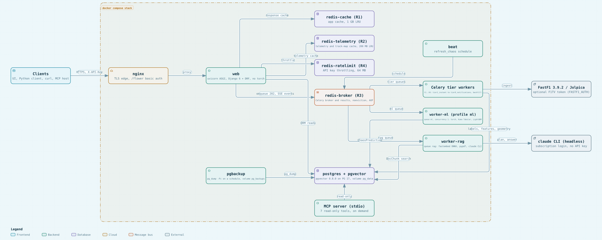

# F1 Control Room

A Django REST API for Formula 1 data: schedules, results, standings, lap and stint analysis, telemetry, and (new in v2) a track map with mini-sectors, a calibrated-probability "Chaos Point" race-disruption predictor, and a cited rules assistant for FIA regulations and stewards' decisions. The data comes from FastF1 and Jolpica.

Why it exists: F1 data is easy to get and hard to serve. FastF1 loads can take a minute, telemetry payloads are large, and nothing public reports how well calibrated its predictions are. This project serves stored results fast, queues the slow work instead of blocking on it, keeps the heavy ML out of the web process, and publishes its own evaluation numbers, including the ones that are still missing.

Every number in this file cites its source file. Sources:
`docs/v2/API_TEST_2026-11-24.md` (called **API test** below), `docs/v2/progress/A0-infra.md` to `A3-stewards.md` (**A0** to **A3**), `backend/api/assistant/README.md` and `backend/api/assistant/evals/results/` (**assistant eval**). VM numbers (2026-11-25) are in `docs/v2/VM_RESULTS_2026-11-25.md`; see also [what is still DEFERRED-VM](#whats-deferred-vm).

- [Architecture](#architecture) / [Quick start](#quick-start) / [Endpoints](#endpoints) / [Examples](#three-example-calls)
- [Design decisions](#design-decisions) / [Performance](#performance-numbers) / [Chaos Point model card](#chaos-point-model-card)
- [Stewards assistant results](#stewards-assistant-results) / [MCP](#mcp-server) / [Python client](#python-client) / [Testing](#testing)
- [Where AI helped, what I rejected](#where-ai-helped-and-what-i-rejected) / [DEFERRED-VM](#whats-deferred-vm)

## Architecture



The diagram was generated with the Archify skill from `docs/v2/diagrams/architecture.json`, which was written from `docker-compose.yml`, `backend/f1_project/celery.py` and `backend/f1_project/settings.py`. Re-render it with
`node <archify>/bin/archify.mjs export-svg architecture docs/v2/diagrams/architecture.json docs/v2/diagrams/architecture.svg --theme light`.

| Service | What it does |
|---|---|
| `nginx` | TLS edge; proxies `/` to web; `/flower/` behind basic auth |
| `web` | uvicorn (2 workers), Django 6 + DRF. No torch, no onnxruntime, no `claude` CLI |
| `worker-t1` to `worker-t6` | Celery tiers: `tier1_instant`, `tier2_fast`, `tier3_medium`, `tier4_telemetry`, `tier5_pagination` + `backfill`, `tier6_notifications` |
| `worker-ml` (profile `ml`) | queue `ml`, concurrency 1: torch, Kumo Tabular, LightGBM. The only image with torch |
| `worker-rag` | queue `rag`: PDF ingest, embeddings (fastembed, ONNX), the assistant agent, the `claude` CLI |
| `beat` | schedules `refresh_chaos` |
| `postgres` | `pgvector/pgvector:0.8.0-pg17`, in the stack, volume `pg_data` |
| `pgbackup` | `pg_dump -Fc` at start and every `BACKUP_INTERVAL_HOURS`, retention `BACKUP_RETENTION_DAYS` |
| `redis-cache` / `redis-telemetry` / `redis-broker` / `redis-ratelimit` | R1 app cache (1 GB, LRU), R2 telemetry cache (200 MB, LRU), R3 Celery broker and results (noeviction, AOF), R4 throttling (64 MB) |

Routing is by task module: `api.trackmap.tasks.*` to `tier4_telemetry`, `api.chaos.tasks.*` to `tier3_medium`, `api.chaos.ml_tasks.*` to `ml`, `api.assistant.tasks.*` to `rag` (`docs/v2/ORCHESTRATION.md`). Source: `docker-compose.yml`, A0.

## Quick start

```bash
cp .env.example .env              # fill SECRET_KEY, ALLOWED_HOSTS, INTERNAL_API_KEY, ADMIN_SECRET, POSTGRES_PASSWORD (openssl rand -hex 24)
htpasswd -c deploy/nginx/.htpasswd admin   # Flower login; must exist before `up`
make build && make up             # postgres, 4 redis, web, workers t1-t6, beat, flower, nginx, pgbackup
make migrate
curl http://localhost/api/docs/   # Swagger UI; schema at /api/schema/
```

The optional workers are separate images: `make build-ml && make up-ml` adds `worker-ml`; `worker-rag` needs the `claude` CLI logged in on the host (`CLAUDE_CONFIG_DIR` in `.env`) and a seeded model cache (`backend/api/assistant/VM_TESTING.md`).

| Make target | What it does |
|---|---|
| `build`, `build-ml` | build the API image, the ML image |
| `up`, `up-ml`, `down`, `ps`, `logs s=<service>` | run the stack |
| `migrate`, `migrate-check`, `shell` | Django management |
| `test`, `lint` | pytest from `backend/` (no `.env` needed), `ruff check` |
| `backup`, `backups`, `restore f=<dump>` | database dumps (`deploy/RUNBOOK_DB.md`) |
| `migrate-from-neon`, `test-neon-migration` | one-off copy from the old Neon database; a rehearsal against a fake Neon |
| `dev`, `dev-down` | hot-reload overlay with a published Postgres port |

**Production** (the Oracle VM, aarch64, 24 GB): follow [`docs/v2/VM_RUNBOOK.md`](docs/v2/VM_RUNBOOK.md), a 12-step ordered checklist with a pass condition per step. Memory limits in the compose file sum to about 10.9 GB without the `ml` profile and 15.0 GB with it (A0, phase 0c).

Every request needs `X-API-Key` (or `?api_key=`). Register at `POST /api/auth/register/`. The docs and schema paths need no key.

## Endpoints

All paths are under `/api/`, all are GET unless noted, all take the API key, and throttling costs by endpoint (`backend/api/throttling.py`: telemetry 5, `assistant_ask` 10, laps and similar 2, most others 1).

**v1 (unchanged by v2)**

| Route | Returns |
|---|---|
| `races/<year>/`, `races/<year>/<round>/` | schedule, race detail |
| `races/<year>/<round>/results/`, `qualifying/`, `sprint/`, `sprint-shootout/`, `practice/<session>/` | session results |
| `drivers/<year>/`, `drivers/<code>/<year>/`, `drivers/<code>/career/` | standings, season, career |
| `drivers/search/?year=`, `drivers/search-by-name/?q=&year=` | driver lookup |
| `constructors/<year>/` | constructor standings |
| `analysis/races/<y>/<r>/laps/`, `stints/`, `pace/`, `tyre-strategy/`, `sector-analysis/` | `?driver=&session=&limit=` |
| `analysis/races/<y>/<r>/telemetry/`, `telemetry/overlay/`, `telemetry/summary/` | per-lap telemetry by distance |
| `unified/races/<y>/<r>/full-session/`, `weather/`, `pit-stops/`, `incidents/`, `positions/`, `drs/`, `track-status/` | session data |
| `auth/register/` (POST), `auth/me/` | API keys |

**v2 additions**

| Route | Returns |
|---|---|
| `analysis/races/<y>/<r>/track-map/?scheme=distance\|corners` | polyline (columnar), corners, DRS zones, mini-sector boundaries |
| `analysis/races/<y>/<r>/mini-sectors/?drivers=VER,NOR&lap=fastest&scheme=&session=` | time per mini-sector per driver, fastest driver per segment |
| `analysis/races/<y>/<r>/telemetry/delta/?ref=VER&cmp=NOR&lap=fastest` | delta-time trace by distance (positive: `cmp` slower) |
| optional on `telemetry/` and `telemetry/overlay/`: `start_m`, `end_m`, `channels=speed,throttle,brake`, `format=rows\|columnar` | trimmed payload; with none of them the response is byte-identical to v1 (8 golden snapshots, A1 1c) |
| `chaos/races/<y>/<r>/?model=auto\|kumo_calibrated\|kumo\|baseline` | Chaos Index, per-target probabilities with p10/p90, top factors, a `model` block that says which model answered and whether it is a fallback |
| `chaos/races/<y>/<r>/drivers/`, `chaos/races/<y>/<r>/laps/?target=` | per-driver DNF and stop risk; per 5-lap-window SC risk |
| `chaos/circuits/`, `chaos/circuits/summary/`, `chaos/circuits/<slug>/history/` | circuit list; one-response safety-car and DNF rates for every circuit; one circuit's history |
| `chaos/drivers/<code>/profile/` | driver tendencies with intervals (shrunk toward team and field) |
| `chaos/model/` | latest model runs, calibration tables, leave-one-season-out backtest (`per_season` included); empty 200 until a run exists |
| `POST assistant/ask` `{question, year?, round?}` | Server-Sent Events: `status`, `token`, `citations`, then `done` or `error` |
| `assistant/ask/<task_key>/events` | reconnect: replays the stored events; resume with `Last-Event-ID` or `?from=<seq>` |

Status codes the v2 endpoints add: **202** `{status: "pending", task_key, detail}` when the work is queued and has no result yet; **503** `{status: "failed", reason, retry_after}` with a `Retry-After` header after a recent build failure; **404** for an unknown circuit or driver (never a silent substitute); **400** for bad parameters.

## Three example calls

```bash
export KEY=...  BASE=https://your-host

# 1. Three channels, columnar, one 1 km slice of lap 10 (4.9 KB against 51.5 KB for the default, in the API test)
curl -H "X-API-Key: $KEY" \
  "$BASE/api/analysis/races/2026/5/telemetry/?driver=NOR&lap=10&format=columnar&channels=speed,throttle,brake&start_m=1000&end_m=2000"

# 2. How chaotic will this race be? (202 + task_key the first time, 200 once predictions are stored)
curl -H "X-API-Key: $KEY" "$BASE/api/chaos/races/2026/5/"

# 3. Ask the stewards (streams SSE; -N turns off curl's buffering)
curl -N -X POST "$BASE/api/assistant/ask" -H "X-API-Key: $KEY" -H "Content-Type: application/json" \
  -d '{"question": "What penalty applies for causing a collision?", "year": 2026}'
```

## Design decisions

- **Additive only.** v2 adds routes, apps and tables. No v1 route, field or model changed. Eight golden snapshots of the telemetry views compare raw response bytes, including a second pass on rows that carry the new time array, to prove it never leaks into the default response (A1 1c). A `snapshot_routes.py record|compare` harness exists for 10 routes; the real before/after run on production data is DEFERRED-VM (A0).
- **Caching tiers.** R1 holds app responses, R2 telemetry and track geometry (stored with no expiry, keyed by circuit and layout hash), R3 is the Celery broker and must never evict, R4 holds throttle counters. A request checks Redis, then the database, then enqueues. Chaos responses carry a version counter that is bumped whenever a `ModelRun` is saved or `build_labels` runs; TTLs are 6 h (race, drivers, laps), 1 h (circuit history, driver profile, circuits summary) and 10 min (model page) (A2 2e, 2g).
- **Nonblocking 202 and SSE.** v1 views that miss cache and database enqueue a task and stream one SSE frame when it finishes. The v2 track-map, mini-sectors, delta and chaos views never block: they return 202 at once, and a recent failure returns 503 with `Retry-After`. 503 was chosen over 424 and 500 because it says "temporarily unusable, retry later" and proxies understand it (A1 1e). The assistant streams five event types from a Redis list with a 15-minute TTL, so a reader that connects late or reconnects replays from the start (A3 3c, 3d).
- **Queue tiers.** Six Celery tiers by cost, plus `ml` (torch, concurrency 1) and `rag`. Torch never loads in the web process: a subprocess test proves that importing the chaos tasks after `django.setup()` loads neither torch nor sdm (A2 2c).
- **Postgres in the stack.** One `pgvector` Postgres holds the app tables and the assistant's vectors, with a backup sidecar. This replaced external Neon, where pgvector would have had to be enabled in production. The one-off Neon copy is `make migrate-from-neon`; its first real-data test found three bugs, now fixed and rehearsed (API test finding 4, A0 0d).
- **FastF1 3.9.2 and optional F1TV auth.** The F1 livetiming archive has answered 401 to everyone since about 2026-10-15, and FastF1 3.9 added an F1TV account login for it. The app switch is `FASTF1_AUTH=none|token` (default `none`): `none` never attempts a login or sends a token; `token` sends the token saved by a one-time interactive login on the VM, and the app never logs in by itself. The token lives in a named volume, never in git or the image (A0 0d, `docs/v2/VM_RUNBOOK.md` step 6).
- **Claude headless on a subscription, not an API key.** The assistant runs the `claude` CLI as a subprocess on the logged-in subscription (`-p --output-format json|stream-json --json-schema --model ... --tools "" --safe-mode`, an empty temp cwd, never `--bare`). Haiku plans, Sonnet answers. Tests use a fake runner and never start `claude`. The cost is real quota, so `assistant_ask` is priced at 10 request-units against telemetry's 5 (A3 3c).
- **Rerank off by default.** A MiniLM cross-encoder raised MRR from 0.588 to 0.660 on 77 gold questions but lowered recall@8 from 0.870 to 0.844 and cost about 2.1 s per search, and the agent reads up to 10 items, so ordering matters less than recall (A3 3d).

## Performance numbers

Only measured numbers, with their conditions.

**Telemetry payload and latency, real 2026 round 5 data** (API test): production compose on amd64 Docker Desktop, through nginx, data copied from Neon, NOR lap 10, one request each (not a distribution).

| Request | Time | Size |
|---|---|---|
| default rows | 403 ms | 51.5 KB |
| `format=columnar&channels=speed,throttle,brake` | 286 ms | 13.6 KB (74% smaller) |
| the same, plus `start_m=1000&end_m=2000` | 348 ms | 4.9 KB (72 rows) |

**Payload table, A1 fixture** (A1 1c): one synthetic lap of 400 samples and 9 channels, Django test client, SQLite, median of 30 requests, includes auth and throttle overhead. Part of the time gain is that the non-default path skips the row serializer.

| Request | Raw bytes | Gzip bytes | Server ms |
|---|---|---|---|
| 1 lap, rows (default) | 65,650 | 6,533 | 11.2 |
| 1 lap, columnar | 20,246 | 4,954 | 4.3 |
| 1 lap, rows, 3 channels | 44,934 | 4,963 | 7.7 |
| 1 lap, columnar, 3 channels | 14,225 | 3,728 | 4.2 |
| 1 lap, columnar, `start_m=1000&end_m=2000` | 4,204 | 1,353 | 3.2 |
| 2 laps, rows | 130,966 | 12,516 | 22.0 |
| 2 laps, columnar | 39,962 | 7,315 | 6.3 |

Columnar is 69% smaller raw and 24% smaller gzipped for one lap (A1 1c). Gzip narrows the gap because repeated keys compress well.

**Route latencies, real data** (API test, same setup, single requests, so read them as a first sample): season and race lookups 22 to 1,712 ms; constructors and drivers 26 to 43 ms; laps, stints, pace, tyre strategy 39 to 343 ms (laps payload 276 KB); weather and incidents 33 to 49 ms; telemetry overlay 1.26 s (270 KB); telemetry summary 1.49 s (149 KB); `chaos/races/2026/5/` 6.3 s on the first call (built from real data: labels, 66 races of features, 163 baseline predictions), 3.1 KB; `chaos/model/` 132 ms; `chaos/drivers/NOR/profile/` 5.1 s. `track-status` took 55 s and `track-map` 37 s because they loaded FastF1 live on a network with no livetiming access; the v2 track-map no longer blocks (A1 1e), and the real-data re-run is DEFERRED-VM.

**Retrieval latency** (A3 3b, dev PC, 200-chunk corpus): query embedding 7 ms median, retrieval without rerank 26 ms; with the 79-source snapshot, 79 ms median excluding query embedding (assistant eval).

**Not measured:** arm64 latencies, Kumo inference time, cache hit rates, anything on the VM.

## Chaos Point model card

**Status (2026-11-25): a first real-data backtest has run on the VM, on two seasons only (2024 and 2025, 66 races), because the stored labels and the FastF1 cache cover only those. Read it as a smoke result, not a performance claim.** Mean Brier / log-loss / ECE over the five (scope, target) cells: `beta_binomial` 0.165 / 0.465 / 0.259, `lightgbm` 0.082 / 0.252 / 0.090, `kumo` 0.109 / 0.368 / 0.143. Race-level `sc_vsc_red` (46 races, base rate 0.413): Kumo AUC 0.85 and Brier 0.133, LightGBM AUC 0.43 (worse than chance) and Brier 0.264, baseline AUC 0.30. Lap-window `sc_vsc_red` (579 windows, base rate 0.055): LightGBM AUC 0.72, Brier 0.0585; Kumo AUC 0.45. **The `unlucky_stop` target has zero positive labels in this data (base rate 0.000, AUC undefined), so its Brier and log-loss numbers say nothing**: the track-status table is empty, so the stop cannot be tied to a safety car. The Canada sanity check (about 60%) could not run: only two races of the 2024 and 2025 seasons are Canada. Full table and caveats: `docs/v2/VM_RESULTS_2026-11-25.md`.

**What it predicts.** For each race, each driver-race and each 5-lap window. Targets: `sc_vsc_red` (safety car, virtual safety car or red flag), `dnf_mechanical` (engine, gearbox, hydraulics, electrical, brakes, chassis), `dnf_incident` (accident, collision), `slow_stop`, `unlucky_stop` (pitted under green within 2 laps before an SC or VSC). `dnf_other` feeds no target. The Chaos Index is the expected number of disruptive events: the sum of the three disruptive targets' expected counts from the same run. Its band is a sum of per-entity p10/p90, labelled conservative and not joint. Slow and unlucky stops are shown but are not in the index (A2 2e).

**Data.** Labels are built from stored tables: track status, race-control messages, race results with a status-to-group map (version 2), and pit stops. Slow stop uses pit-lane time (the stored value), threshold = season p90 over stored stops, minimum 20 stops. Circuit traits come from a 32-circuit seed (`data/circuits.yaml`); circuit type is marked `verified: false` for the 31 circuits of the first seed; wall proximity, overtaking index and elevation are null by design. Which seasons are populated is a property of the database: the Neon copy used in the API test holds results for 3 seasons, telemetry for two 2026 races, no track status and no stored qualifying (API test).

**Features.** About 50 numeric columns, a few thousand rows (A2 2b). Era flag (2022 and later), circuit traits (NaN when unknown), race weather means, grid position, pit-lane start, window position, hierarchical posterior rates at each level (global, circuit type, circuit; team, driver) and a circuit pit-lane-time ratio. Categoricals are encoded (circuit type one-hot; team and driver identity enter through their historical rates). `live_only` columns (for example a restart flag) are dropped for pre-race prediction.

**Baseline.** Hierarchical Beta-Binomial: a uniform root prior, each level's prior is its parent's posterior mean times a strength (default 8, tuned per held-out season on a grid of 2, 4, 8, 16, 32), updated by that level's counts. Probability is the posterior mean; p10 and p90 are Beta quantiles.

**Kumo Tabular.** NVIDIA `structured-data-models` 0.3.0, `KumoTabular`, in-context learning with no training step: earlier races are the context, the target race's rows are the query. Weights `nvidia/Kumo-Tabular` revision v1.0.1 (OpenMDW-1.1), `small` first. Torch and `sdm` are imported only inside `ml_tasks.py`. Context is capped at 50,000 rows and 100 columns. The p10/p90 band is the spread over K=5 fits on random 80% context subsamples ("context bagging"); it measures sensitivity to the context sample, not a full predictive interval. Hardware is CPU on the VM (`docs/v2/plans/KUMO_SETUP.md`); none of this has run on real Kumo weights yet.

**Calibration.** Isotonic regression per (scope, target), fitted on raw predictions of earlier finished races against their outcomes. It needs at least 200 points and both classes; otherwise it is the identity, and the response says `identity (too little backtest history ...)`. Raw and calibrated runs are stored as separate `ModelRun`s so calibration never trains on calibrated output. Reliability is a 10-bin table with ECE, served on `/api/chaos/model/` (A2 2c). The calibration plot for the README is DEFERRED-VM.

**Leakage controls.** Races are walked in (year, round) order and each race's rows are built from the tally before the race is added. Tests change a race's labels and prove that its rows and every earlier row are unchanged. In leave-one-season-out, the held-out season is built from history but never added to it, so no training row in a later season carries it; changing every label of the held-out season leaves every feature row of every season identical (A2 2b, 2d). Prior strength is tuned only on other seasons.

**Backtest design.** Leave one season out, 2018 to 2025, same splits and rows for every model: `beta_binomial`, `lightgbm` (CPU), `kumo`. The raw `year` column is dropped for learned models (the era flag carries the 2022 change). Metrics per (scope, target, season) and pooled: Brier, log-loss, ROC-AUC (null when a cell has one class), and 10-bin reliability with ECE. Sanity check: Canada's safety-car share should be near 60% (tolerance 15 points, at least 5 races). Command: `manage.py chaos_backtest --seasons 2018-2025 --models beta_binomial,lightgbm,kumo --backfill-kumo` (A2 2d).

**Limitations.**
- No real backtest yet (above). The LightGBM adapter test ran against the real library but on a synthetic table.
- SC laps come from race-control text. `TrackStatusData.lap_number` is almost always None, so an event with no matching message counts at race level but not in a window. Run the Mendeley cross-check script on the VM before trusting SC scores (A2 2a).
- Slow stop uses pit-lane time, not stationary time, and a season percentile is confounded by pit-lane length per circuit (A2 2a).
- Race-scope `slow_stop` and `unlucky_stop` sit near 1 and are more informative per driver or per window. "Unlucky stop" is mostly luck and strategy: read it as a tendency with wide intervals, never as a skill rating.
- The DNF mapping was built from the Ergast/Jolpica status vocabulary, not from stored rows. Check it on real data.
- Small data: a few thousand driver-race rows, and the 2018 to 2021 cars differ from the ground-effect era.
- The circuit for 2026 R5 came out `unknown` in the API test; fixed in 2f by matching schedule location and event name, but not yet re-run on the real schedule (A2 2f).

**Changelog.**
| Phase | Change |
|---|---|
| 2a | labels, DNF mapping v1, circuit seed, Mendeley cross-check script |
| 2b | DNF mapping v2 (adds `chassis`), features, Beta-Binomial baseline |
| 2c | Kumo adapter, context bagging, isotonic calibration, Celery chain, `refresh_chaos` |
| 2d | leave-one-season-out backtest, metrics, LightGBM reference, Canada check |
| 2e | endpoints, explicit model choice with labelled fallback, cache versioning |
| 2f | circuit matching by location and event name, automatic key linking, 32 circuits (adds Madrid), loud unmatched-circuit logging |
| 2g | `per_season` backtest metrics, `chaos/circuits/summary/` |

## Stewards assistant results

Answers questions about the FIA regulations and stewards' decisions from a local corpus, with document, page, article and FIA URL on every citation, and "Evidence not found." when the corpus has no answer. Full notes: `backend/api/assistant/README.md`.

**Corpus for the eval.** 79 sources, 1,728 chunks, snapshot hash `59dbbf22...` (`evals/snapshot.json`); the harness restricts retrieval to those sources so later corpus growth does not change the numbers. **Eval set:** 97 questions: 52 rule lookups, 22 penalty precedents, 3 event notes, 10 unanswerable, and 10 race-data questions that are not scored because the local database had no race data. 77 questions have gold citations (A3 3d).

**Retrieval only, no LLM** (77 gold questions; `20261124-101704_retrieval.json`, identical to the 3d run for every mode after the chunker fixes):

| Mode | recall@8 | MRR | median ms |
|---|---|---|---|
| FTS only | 0.714 | 0.546 | 79 |
| vector only | 0.818 | 0.514 | 79 |
| RRF (k = 60) | **0.870** | 0.588 | 79 |
| RRF + rerank, first 700 chars | 0.844 | 0.660 | 2,137 |
| RRF + rerank, full text | 0.857 | 0.669 | 5,509 |
| RRF + rerank 700 + year filter (76 questions naming a year) | 0.895 | **0.795** | 2,173 |

By type, recall@8 / MRR: rule lookups RRF 0.81 / 0.46; precedents RRF 1.00 / 0.88 (FTS matches names and numbers literally). Latencies were higher in the 3e re-run because ingestion ran at the same time; the table shows the quiet 3d figures (A3 3d, 3e).

**End to end** (`20261124-095503_e2e.json`, live `claude`, after the evidence-id fix): 10 questions, 53 calls, $0.4479 total (about $0.45 per 10 questions).

| Metric | Result |
|---|---|
| Answer correctness (Haiku judge) | 9 / 10 (the miss, q007, gave the 3-engine limit and omitted the turbocharger limit) |
| Citation hit rate (answerable) | 1.0 on 8 questions |
| Citation precision | 0.70 (extra citations are mostly neighbouring paragraphs and other years' copies of the same article) |
| Evidence not found (unanswerable) | 2 / 2 refused |
| Latency | 77.5 s median per question, 2.4 planner rounds on average; measured while ingestion ran |
| Quotes over 300 characters | 1 (q022); counted, not enforced, because the text is already streamed |

Read these with their limits: 10 questions, an LLM judge (Haiku at low effort), and the cost and latency of a subscription-backed run rather than a tuned service.

**Decisions.** fastembed with `bge-small-en-v1.5` (no torch, about 100 MB against about 2 GB; the registry serves the INT8 export) instead of sentence-transformers; `pypdf` (pure Python, about 0.5 s per page) instead of faster but AGPL PyMuPDF; no `bge-reranker-v2-m3` (about 14x MiniLM-L-12's compute, an estimate, and multilingual for an English corpus); rerank off by default; year inferred from the question; the planner's first round must search; citations built in Python from the evidence ids the answer cites, so a source cannot be invented; at most 10 evidence items reach the answer prompt (A3 3c, 3d).

**FIA terms.** The FIA site terms (clauses 3.4, 3.5, 3.9) reserve copyright in FIA publications and allow only short quoted extracts with a reference. The project owner reviewed this and approved public use of the assistant. To stay inside the terms: the PDFs are gitignored and never served, citation extracts are capped at 300 characters with the FIA URL, the fetcher honours `robots.txt` (Crawl-delay 10 s) and identifies itself generically (A3 3a, 3b).

## MCP server

Seven read-only tools over stored data, stdio transport (MCP Python SDK v2, `mcp==2.3.0`, `MCPServer`): `f1_search_documents`, `f1_get_chaos`, `f1_get_track_map`, `f1_get_incidents`, `f1_get_track_status`, `f1_get_race_results`, `f1_get_race_schedule`. No writes and no live FastF1. A tool whose data is not stored returns an error naming the web endpoint that populates it.

```bash
cd backend && python stewards_mcp/server.py    # register in an MCP host as: command "python", args ["stewards_mcp/server.py"], cwd backend
```

It is not a permanent compose service; an on-demand `mcp` profile block is drafted in A3 3e but not wired into `docker-compose.yml`. The folder is named `stewards_mcp` because a package called `mcp` would shadow the SDK (A0 0d, A3 3e).

## Python client

`clients/python/` is an installable package, `f1controlroom` 0.1.0 (MIT), built on `httpx`: `X-API-Key` auth, a method per public GET endpoint (v1 and v2), 202 polling with `wait=`, 503 + `Retry-After` retries, and `ask()` as an iterator over the assistant's SSE events with automatic reconnect. See [`clients/python/README.md`](clients/python/README.md). It is not published to PyPI.

```python
from f1controlroom import F1Client
c = F1Client("YOUR_KEY", "https://your-host")
print(c.chaos_race(2026, 5, wait=120)["chaos_index"])
```

## Testing

```bash
make test                                 # = cd backend && python -m pytest -q   (no .env needed)
pip install -r backend/requirements-dev.txt          # CI installs these as separate steps:
pip install -r backend/requirements-rag.txt          #   huggingface-hub needs click>=8.4.2, requirements.txt pins 8.3.1
pip install --no-deps fastembed==0.9.1
make lint                                 # ruff check (pyflakes-level ruleset, backend/ruff.toml)
```

On 2026-11-25 on this branch (Windows, Python 3.13.7, no `.env`, rag requirements installed): **715 passed, 21 skipped, 0 failed** in 200 s (skips are opt-in tests, for example the live-Postgres pgvector test that needs `STEWARDS_PG_DSN`). The client package has its own 19 tests (`clients/python`). The suite was about 210 tests when v2 started (`docs/v2/ORCHESTRATION.md`).

`backend/conftest.py` raises on any non-loopback socket connect, so a test cannot reach FastF1, Jolpica, Hugging Face, the FIA site or `claude` by accident. `settings_test` swaps Postgres for SQLite and Redis for memory caches. CI (`.github/workflows/docker.yml`) runs three jobs on push and pull request: pytest (Python 3.13), ruff (clean on this branch), and a compose validation plus an arm64 and amd64 image build. The older `.github/workflows/ci.yml` still runs `manage.py test` on Python 3.12.

## Where AI helped and what I rejected

Claude Code agents wrote the v2 branches in parallel (infra, track map, chaos, stewards, docs), each in its own worktree and under the contract in `docs/v2/ORCHESTRATION.md`; an orchestrator reviewed and merged every phase. What follows comes from their progress files.

**Where it helped.** Reading the existing code before changing it caught real bugs the brief did not mention: `telemetry/summary/` had never worked on master (missing import, a serializer called without `many=True`, a missing `limit_max`), the Docker healthcheck hit a route that returns 404 so every container would have been `unhealthy`, `entrypoint.sh` carried CRLF into the image, `beat` and `flower` inherited a healthcheck for a server they do not run, five latent `NameError`s sat behind a `finally`, and a script held hard-coded proxy credentials in git history (rotate that password). Throttle costs set inside `get()` never applied, because DRF throttles run before the handler; the assistant view sets it in `initial()` and the old views are still wrong (A3 3c).

**Bugs the evaluations found.** The first end-to-end run reported a citation hit rate of 0 of 5. The cause was an id bug in the agent: every hit from one tool call received the same evidence id, so citation objects pointed at the wrong documents while the answer text was still right. The unit tests had missed it because their fake retriever returned one hit per call. After the fix: 1.0 on 8. The same evaluation found that Haiku at low effort sometimes answered a rules question without searching (a false "Evidence not found."), two chunker bugs (a `54) PENALTIES` heading mislabelled as another article, and technical-regulation contents pages indexed as chunks), and a decision misfiled as an event note (A3 3d).

**What I rejected, with the reason.**
- `bge-reranker-v2-m3`: about 14x the compute of MiniLM-L-12 (an estimate from parameter counts, not measured), multilingual for an English corpus. Dropped.
- The MiniLM reranker as a default: it lowered recall@8 (0.870 to 0.844) for +0.066 MRR at about 2 s. Off by default, one environment variable to enable.
- sentence-transformers (torch, about 2 GB) and PyMuPDF (AGPL).
- 424 and 500 for "build failed": 503 with `Retry-After` says what a client should do.
- Douglas-Peucker for track geometry: a uniform 1,500-point distance grid keeps index and distance linear, which mini-sectors and delta interpolation need.
- Kumo regression quantiles for the bands: every stored target is binary, so the band is context bagging, and it says so.
- A calibration that trains on calibrated output: raw and calibrated runs are kept apart.
- Silent model fallback: the chaos `model` block always says which model answered and why.
- Fixing `telemetry/summary/` quietly inside the optional-parameters change: it was reported separately, then fixed in its own phase (A1 1c, 1d).

**What the AI could not settle.** The LLM judge is Haiku and the e2e sample is 10 questions. The Kumo path has never run on real weights. The track map has never been built from live position data, so finding 1 of the API test (build fallback) is code-tested only. The FIA-terms question was a legal decision, and it was a human's (A3 3a).

## What's DEFERRED-VM

Items that need the Oracle VM, real F1 data or a large download. The ordered procedure is [`docs/v2/VM_RUNBOOK.md`](docs/v2/VM_RUNBOOK.md).

| Item | Status | Source |
|---|---|---|
| Full stack on the VM (arm64 images, healthchecks, `worker-ml` / `worker-rag` images) | **done 2026-11-25**: all images built on arm64, every service healthy, every queue has a consumer, `migrate --check` clean; stack runs beside the legacy one on loopback port 8088 (the host nginx owns port 80) | VM results, steps 2, 3, 10 |
| Before/after snapshot of 10 v1 routes on production data | **done 2026-11-25**: 9 of 10 byte-identical; `/api/schema/` differs only by v2 additions (14 new paths, 2 existing telemetry routes gained optional query parameters, nothing removed) | VM results, step 9 |
| Neon to stack migration | **done 2026-11-25** on real Neon: row counts identical, migrations clean, `vector` present; `pg_trgm` was missing after the restore and was created by hand (see VM results, finding 1) | VM results, step 4 |
| Kumo smoke test, weight download, real inference, per-fit timing, `KumoRelational` | **partly done 2026-11-25**: weights downloaded (688 MB, small and medium), offline smoke passes, real inference works (fit 3.9 s and predict 1.6 s for 300 and 100 rows of toy data on 2 CPU cores); `KumoRelational` not attempted | VM results, step 7d |
| Leave-one-season-out backtest, calibration backfill, calibration plot, Canada check | **partly done 2026-11-25**: backtest and Kumo backfill ran (34 min, 2024 to 2025 only, 66 races, 45 races of raw Kumo predictions stored); 2018 to 2023 have no labels or cache; calibration plot data are in the saved report; Canada check not possible with two Canada races | VM results, step 7d |
| Mendeley SC cross-check, DNF mapping check against stored statuses | script written, not run | A2 2a |
| Circuit matching on the real 2026 schedule | **checked 2026-11-25**: the run logged `UNMATCHED CIRCUIT 2026 R5 (no schedule row)`: the stored 2026 schedule has no round 5 row, so this is missing data, not a missing alias | VM results, finding 5 |
| Track-map build from live position data; build fallback | **partly done 2026-11-25**: 109 geometries across 28 circuits built from the cache; 2024 round 1 still answers 503 (geometry could not be built); live position data needs the F1TV login | VM results, step 7b |
| Re-run `populate_telemetry --force` to add the time channel to old rows | not run | A1 1c |
| `assistant/ask` through nginx on the stack | not run (`worker-rag` not built); live `claude` checks were run on a dev PC | API test, A3 |
| Reranker and embedding latency on arm64 | not measured | A3 3b |
| Full corpus fetch (2022 Technical, 2024 Technical, 2026 Section C, more decisions) and the 10 race-data eval questions | partly fetched; TLS drops from this network | A3 3d |
| F1TV one-time login (`FASTF1_AUTH=token`) | steps written; needs a human to type the password | A0 0d |
| MCP compose service | drafted, not wired | A3 3e |
| Hero GIF for this README | not made (needs the UI) | `docs/v2/plans/01_F1_CONTROL_ROOM_BACKEND.md` |

## License

Code: see the repository licence. The Python client in `clients/python/` is MIT. FIA documents are not part of this repository.
