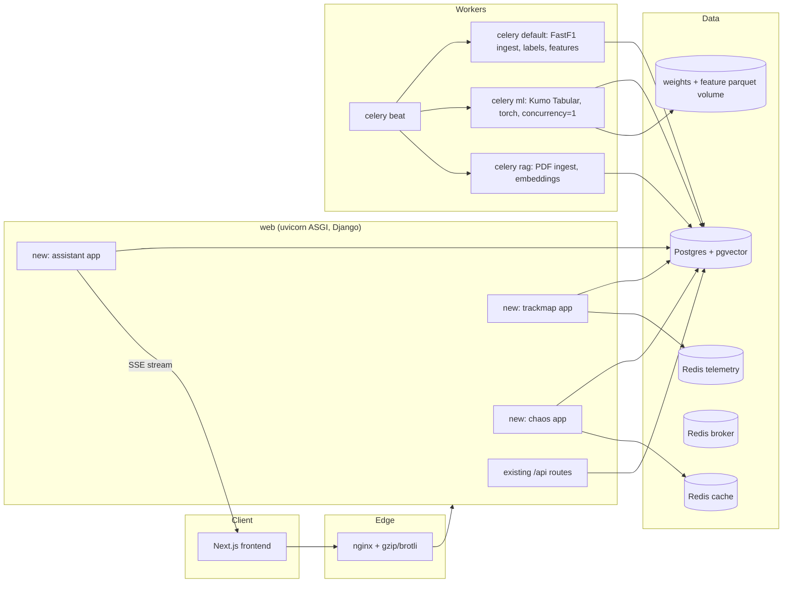

# F1 Control Room v2: Architecture Plan

Status: draft for review. Branch base: `All_Endpoints_integrated` (72 commits, ~33k lines, 214 tests).

## 1. Ground rules

- **Additive only.** Every existing `/api/...` route, response shape and model stays exactly as it is. New features get new routes, new Django apps and new tables. The only change to existing endpoints is new *optional* query parameters, and their defaults give the same behaviour as today.
- **Reuse what already works:** the `nonblocking` pattern (a 200 JSON response, or SSE with task progress), `APIKeyThrottle` tiers, the Celery queue manager, the 4-Redis split, drf-spectacular docs and the `payload` JSON tables.
- **Heavy ML never runs inside the web process.** Torch and model weights live only in a dedicated Celery worker. The web tier serves predictions that were already computed and stored.
- **Everything ships with numbers:** response times, cache hit rates and model calibration go in the README and on a model page in the UI.

## 2. What exists today (from the code)

| Layer | Current |
|---|---|
| API | Django 6 + DRF, routes under `/api/` (schedule, results, drivers, constructors, `analysis/*`, `unified/*`, auth, task management) |
| Data sources | FastF1 3.8.1, Jolpica client |
| Storage | Postgres (trigram extension), with `payload` JSON tables per session: `PitStopData`, `IncidentData`, `TrackStatusData`, `PositionData`, `DRSData`, `WeatherData`, `DriverTelemetry`, `DriverLapAnalysis` |
| Async | Celery (Redis 3 is the broker), celery-beat, Redis pub/sub, SSE streaming of task results |
| Caches | Redis 1 for the app, Redis 2 for telemetry, Redis 4 for other caches |
| Telemetry | `lap.get_car_data().add_distance()`, so speed, throttle, brake and gear by distance. **No X/Y positions yet**, which is why there is no track map. Distance-window slicing already exists in `analysis.py` and `unified_service.py`. |

## 3. Target architecture



The new Django apps are `api/trackmap`, `api/chaos` and `api/assistant`. Each has its own `urls.py`, mounted with `include()` in `api/urls.py`, which is a one-line addition per app.

Celery queues: the existing default queue, plus `ml` and `rag`, each with its own worker container. The `ml` worker image is the only one that installs torch.

## 4. Feature A: track map, mini-sectors and telemetry lab (backend)

**New data**

- `TrackGeometry(circuit_key, year, layout_hash, points, corners, mini_sectors, source)`:
  - `points` holds downsampled X/Y/Z and distance arrays, taken from the pole lap via `lap.get_telemetry()`, which merges position and car data.
  - `corners` comes from `session.get_circuit_info()` (number, letter, angle, distance).
  - `mini_sectors` holds the boundaries in metres. Default to 25 equal-distance segments, with corner-anchored segments as an alternative.
  - Cache this permanently per layout. Layouts rarely change, and `layout_hash` detects when one does.

**New endpoints** (all GET, API-key throttled, cached in Redis 2)

| Route | Returns |
|---|---|
| `/api/analysis/races/<y>/<r>/track-map/` | Polyline (columnar arrays), corners, mini-sector boundaries, DRS zones (derived from the pole lap's DRS channel) |
| `/api/analysis/races/<y>/<r>/mini-sectors/?drivers=VER,NOR&lap=fastest` | Time per mini-sector per driver, fastest driver per segment (the purple-sector map) |
| `/api/analysis/races/<y>/<r>/telemetry/delta/?ref=VER&cmp=NOR&lap=fastest` | Delta-time trace by distance |

**Optional parameters on existing telemetry routes** (default behaviour unchanged)

- `start_m` and `end_m` slice to a track section, using the slicing code that already exists.
- `channels=speed,throttle,brake` trims the payload.
- `format=columnar` returns `{distance: [...], speed: [...]}` instead of a list of row dicts. This is much smaller, because keys are not repeated per sample (measure it and put the number in the README), and it is the shape uPlot consumes directly.

## 5. Feature B: Chaos Point

### 5.1 What it predicts

For each race, and for each 5-lap window within a race:

| Target | Label source (already stored) |
|---|---|
| SC / VSC / red flag | `TrackStatusData` codes: 4 = SC, 6 = VSC, 5 = red. Cross-check against race-control messages. |
| Mechanical DNF | `RaceResultData` status strings mapped into groups (engine, gearbox, hydraulics, electrical, and so on) |
| Accident / driver-error DNF | Same status mapping (accident, collision, spun off) |
| Slow pit stop | `PitStopData` stationary or lane time above a per-season percentile |
| Unlucky stop | Driver pitted under green within 2 laps before an SC/VSC deployment |

The **Chaos Index** is the expected number of disruptive events in the race, built from the calibrated per-target probabilities. Each target is also shown separately, with an uncertainty band.

"Unlucky stop" is mostly luck and team strategy. Show it as a team or driver tendency with wide intervals, never as a skill rating.

### 5.2 Pipeline (Celery chain, triggered by beat before each race weekend and after each race)

1. `build_labels` (default queue) writes `RaceEventLabel` rows from the existing tables.
2. `build_features` (default queue) writes feature rows to Parquet on the volume and records their version in `FeatureSet`.
3. `run_baseline` (default queue) computes hierarchical Beta-Binomial rates, shrunk from circuit to circuit type to global, and from driver to team to global.
4. `run_kumo` (ml queue) runs NVIDIA Kumo Tabular in-context: historical rows are the context, the upcoming race's rows are the query.
5. `calibrate_and_store` (ml queue) applies isotonic calibration fitted on backtest predictions, then writes `ChaosPrediction` rows tagged with `ModelRun`.

### 5.3 Model: NVIDIA Kumo Tabular

- **Package:** `structured-data-models` (`import sdm`, `from sdm.models import KumoTabular`). Code is Apache-2.0 and weights are OpenMDW-1.1, which allows commercial use. Released 2026-09-28. Sizes are small, medium and large, from 27M to 215M parameters.
- **No training step:** it predicts by in-context learning over labelled rows. Classification returns class probabilities. Regression returns 999 quantiles, which gives free uncertainty bands for the slow-stop targets.
- **Constraints that shape the feature design:**
  - Features must be numerical, so categoricals (circuit type, team, compound) need encoding.
  - Missing values are fine.
  - Pretraining scope is up to 60,000 rows and 100 columns. Driver-race rows (about 20 × 24 × 8 seasons ≈ 3,800) fit easily. Per-lap rows (about 90,000 for 2022–25 alone) do not, so use 5-lap windows or sample the context.
- **Upgrade path:** `KumoRelational` in the same package takes races, drivers, circuits and laps as linked tables, so there is no manual flattening. Try it after the tabular version works.
- **Hardware:**
  - The library is GPU-first, but `device="cpu"` is supported and its Triton kernels fall back to PyTorch on CPU.
  - Predictions are batch jobs run before each race, so CPU latency on the Oracle VM is acceptable. Start with `size="small"` and time it.
  - Backtests can run on a free Colab or Kaggle GPU.
  - Not yet tested end to end: the Hugging Face weight download was blocked in my sandbox, so the first job on the VM is a smoke test.

### 5.4 Evaluation (the part that makes it credible)

- **Backtest:** leave one season out across 2018–2025, plus an era flag for the 2022 regulation change.
- **Comparison:** Kumo vs the Beta-Binomial baseline vs a LightGBM reference, all on the same splits.
- **Metrics:** Brier score, log-loss, ROC-AUC, and calibration curves (reliability bins). None of the public F1 work I found reports calibration, so this is the differentiator.
- **Sanity check:** historical SC rates per circuit should reproduce known figures, such as McLaren's roughly 60% for Canada.
- **Published on** `/api/chaos/model/` and on a model page in the UI.

### 5.5 New tables and endpoints

Tables:
- `CircuitProfile`: type, length, corners, street flag, wall-proximity proxy, overtaking index, elevation range.
- `RaceEventLabel`
- `FeatureSet`
- `ModelRun`: model, size, context rows, metrics JSON, calibration JSON, git SHA.
- `ChaosPrediction`: year, round, scope (`race`, `driver` or `lap_window`), target, probability, p10, p90, `model_run`.

| Route | Returns |
|---|---|
| `/api/chaos/races/<y>/<r>/` | Chaos Index, per-target probabilities and bands, top contributing factors |
| `/api/chaos/races/<y>/<r>/drivers/` | Per-driver DNF and unlucky-stop risk |
| `/api/chaos/races/<y>/<r>/laps/` | Per lap-window SC risk (heat strip) |
| `/api/chaos/circuits/<circuit>/history/` | Historical event rates for that circuit |
| `/api/chaos/drivers/<code>/profile/` | Driver tendencies with intervals |
| `/api/chaos/model/` | Current `ModelRun`, metrics, calibration curve |

## 6. Feature C: Stewards and rules assistant (RAG)

- **Corpus:** FIA Sporting and Technical Regulations by year, stewards' decision PDFs and race-control documents. Ingestion runs on the `rag` queue: PDF parse, section-aware chunking, embeddings, then `DocChunk` rows. These hold the text, a `vector` column (pgvector), a `tsvector`, and the source, year, race, page and section.
- **Retrieval:** hybrid search combining Postgres full-text search (BM25-like) and pgvector, merged with reciprocal rank fusion, then reranked by a cross-encoder.
- **Agent:** LangGraph with tools that call the services directly, not over HTTP:
  - `search_documents`
  - `get_incidents(y, r)`
  - `get_track_status(y, r)`
  - `get_chaos(y, r)`
  - `compare_past_decisions(offence)`
- **Endpoint:** `POST /api/assistant/ask` streams tokens and citations over the existing SSE helper, throttled by API-key tier.
- **Evaluation:** a hand-built set of about 100 questions with gold citations. Report retrieval recall@k, answer correctness and citation accuracy in the README.

## 7. Frontend plan

| Need | Choice | Why |
|---|---|---|
| Telemetry traces | **uPlot** (about 22 kB, canvas) | Built for dense time and distance series. Stack speed, throttle, brake, gear and RPM with one synced cursor. |
| Other charts (stints, strategy, standings, chaos heat strips) | **ECharts** | Broad catalogue, canvas by default |
| Track map | **SVG + d3-zoom** | A few thousand points, easy click and hover on mini-sector paths. Switch to canvas only if needed. |
| 3D showcase | **react-three-fiber + drei** | Track ribbon extruded with FastF1 Z elevation, cars replayed as dots. One page only. |
| Data | TanStack Query, plus a web worker to parse large telemetry | Keeps React out of the redraw path |
| Motion | Framer Motion | Transitions and loading states |

**Pages**

1. **Race hub:** track map coloured by fastest driver per mini-sector, a chaos meter, and tabs for results, strategy and weather.
2. **Telemetry lab:** pick drivers and a lap, then click a mini-sector to zoom every trace to that section. Delta trace on top.
3. **Chaos:**
   - race preview: Index, per-target bands, lap heat strip;
   - circuit history;
   - driver profile;
   - model page with calibration.
4. **Ask the Stewards:** chat with clickable citations.
5. **3D replay:** the showcase page.

**Design:** dark-first, charcoal and sand base with F1 red as the one accent colour, team colours for driver series, and tabular numerals for timing. Build the components with the Claude frontend-design skill.

## 8. Deployment changes (docker compose)

```
web            uvicorn ASGI Django (no torch)
worker-default celery -Q default
worker-ml      celery -Q ml --concurrency=1   (torch + sdm, weights volume)
worker-rag     celery -Q rag                  (parsers, embedding client)
beat           celery beat
postgres       Neon (external) with the pgvector extension; local pgvector container in dev
redis-1..4     unchanged
nginx          unchanged + brotli/gzip for JSON
```

Predictions and track geometry are computed ahead of time, so API reads are database or Redis hits and scale like the current endpoints.

## 9. Repo hygiene (do first)

- Add a README: what it is and why, architecture diagram, quick start, three example requests, live docs link, design decisions, AI-usage note, performance numbers.
- Make `main` the default branch and tag `v1.0` before the v2 work starts.
- Move root `test_*.py` files to `backend/api/tests/` or `scripts/`.
- Remove `misc_2/`.
- Untrack and gitignore: `test_db.sqlite3`, `logs/`, `misc/*.txt`, `celerybeat-schedule*`.
- Move `git-filter-repo` and `GitPython` out of runtime requirements. Decide between `django-background-tasks` and Celery.
- Add a repo description, topics and website. Add a CI badge, plus ruff linting in CI.

## 10. Phases

| Phase | Scope | Target |
|---|---|---|
| 0 | Hygiene and README, `main` branch, v1.0 tag | Week 1 (before the MLH application) |
| 1 | Track map, mini-sectors, delta and columnar endpoints; uPlot telemetry lab and track map in the UI | Weeks 1–3 |
| 2 | Chaos labels, baseline, Kumo smoke test on the VM, backtest, endpoints, Chaos UI | Weeks 3–6 |
| 3 | Stewards assistant, eval set, chat UI | Weeks 6–8 |
| 4 | 3D replay, launch posts (Reddit and X F1 data communities), `pip` client package | Weeks 8–9 |

## 11. Open questions

1. Where does the frontend live (repo or URL)? This plan assumes Next.js.
2. VM specs: CPU type (Ampere ARM?), RAM, disk. This decides Kumo model size and whether pgvector and torch fit alongside the existing services.
3. Which seasons are already populated in Postgres? This decides the backtest range.
4. Embedding model choice for RAG: a hosted API or a local model.
